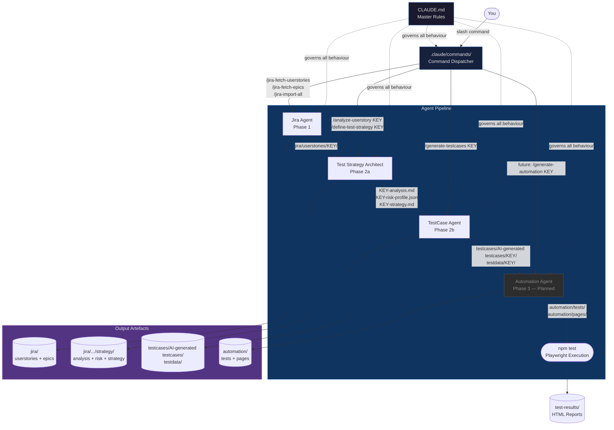
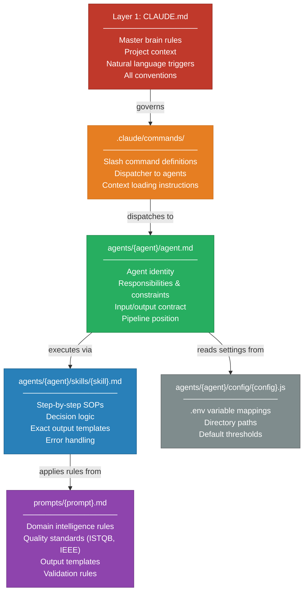
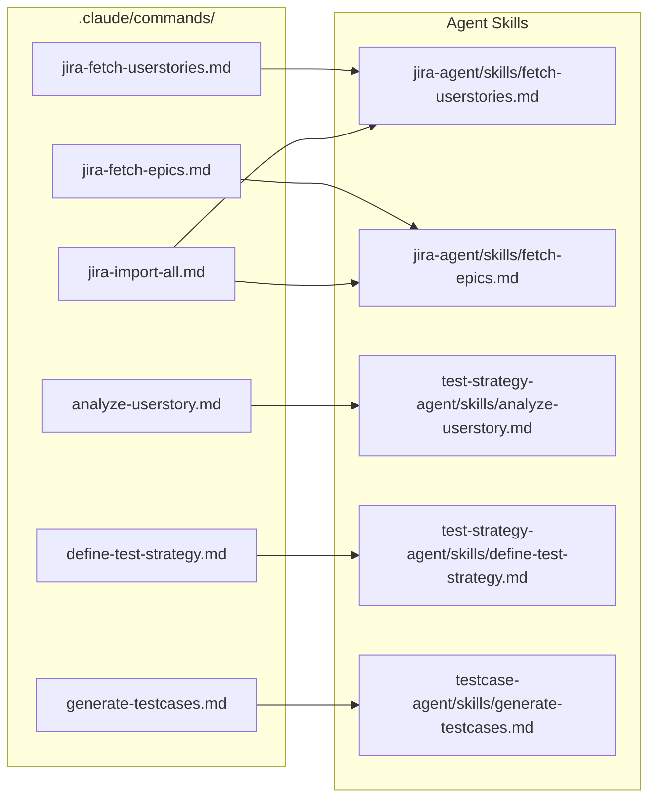
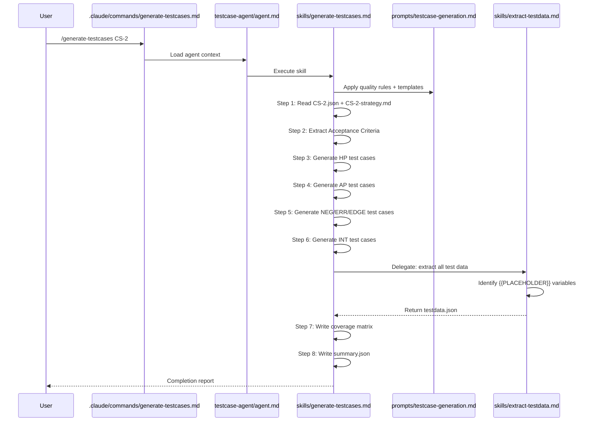
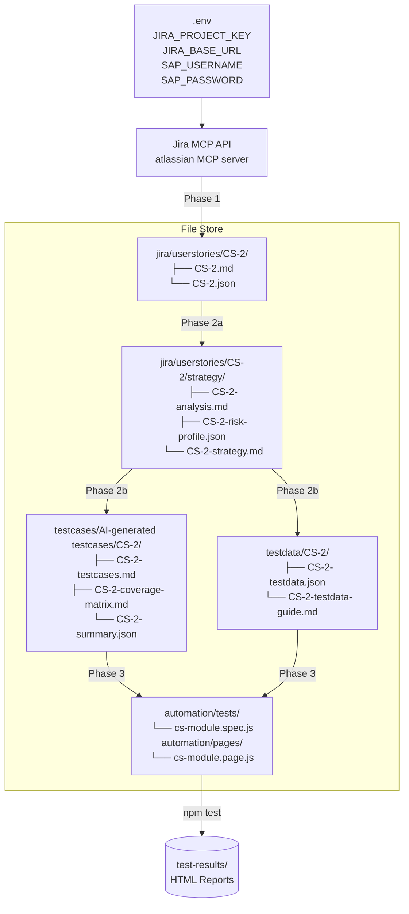
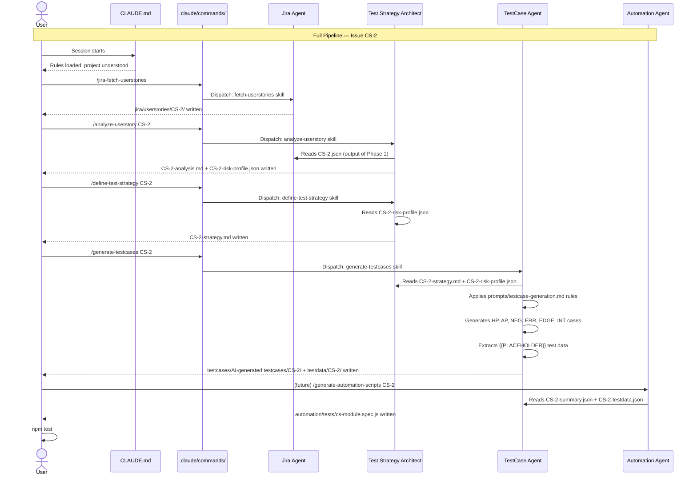

# SAP Agent Teams — Architecture

**Project:** SAP S/4HANA Cloud Test Automation via Agent Teams
**Date:** 2026-05-10
**Version:** 1.0

---

## Table of Contents

1. [Overview](#overview)
2. [The Big Picture](#the-big-picture)
3. [Layer Hierarchy Diagram](#layer-hierarchy-diagram)
4. [Layer 1 — CLAUDE.md](#layer-1--claudemd)
5. [Layer 2 — .claude/commands/](#layer-2--claudecommands)
6. [Layer 3 — agents/{agent}/agent.md](#layer-3--agentsagentmd)
7. [Layer 4 — agents/{agent}/skills/](#layer-4--agentsskills)
8. [Layer 5 — prompts/](#layer-5--prompts)
9. [Layer 6 — agents/{agent}/config/](#layer-6--agentsconfig)
10. [Agent Pipeline — Phase by Phase](#agent-pipeline--phase-by-phase)
11. [Data Flow Diagram](#data-flow-diagram)
12. [Agent Interaction Diagram](#agent-interaction-diagram)
13. [Full End-to-End Workflow](#full-end-to-end-workflow)
14. [Folder Structure Reference](#folder-structure-reference)
15. [Slash Command Reference](#slash-command-reference)

---

## Overview

This project automates SAP S/4HANA Cloud testing using a **multi-agent pipeline**. Each agent is a specialised AI worker responsible for one phase: fetching Jira stories, analysing them, defining test strategy, generating test cases, and ultimately producing Playwright automation scripts.

The entire system is driven by a layered instruction hierarchy — each layer tells Claude who it is, what to do, and how to do it:

```
You (type a slash command)
    → CLAUDE.md           master rules, loaded every session
    → .claude/commands/   expands the slash command into full instructions
    → agents/*/agent.md   defines who is doing the work
    → agents/*/skills/    defines how to do the work, step by step
    → prompts/            quality rules and output templates
    → Output files        jira/, testcases/AI-generated testcases/, testdata/, automation/
```

---

## The Big Picture



---

## Layer Hierarchy Diagram



---

## Layer 1 — CLAUDE.md

`CLAUDE.md` is a project-level instruction file placed at the repository root. Claude reads it **automatically at the start of every conversation**. It is the single source of truth and overrides all of Claude's default behaviour.

It covers everything the project needs Claude to know before any work begins:

| What It Sets | Detail |
|---|---|
| Project context | This is SAP S/4HANA Cloud test automation |
| Folder structure | What every folder in the project means |
| Agent pipeline | All agents, their phases, inputs, and outputs |
| Natural language triggers | "Generate testcases from requirements" → exact execution steps |
| Slash command registry | Every `/command`, what it does, what files it touches |
| Coding conventions | Naming patterns, SAP module codes, test case ID formats |
| Execution commands | How to run Playwright (`npm test`, `npm run test:mm`, etc.) |
| SAP-specific rules | Login flow, URL, credential handling, UI patterns |

> **Analogy:** `CLAUDE.md` is the **employee handbook + project brief** that every team member reads on Day 1. It sets the rules of the game before anything else happens.

**Position in hierarchy:** Topmost. All other layers are subordinate to CLAUDE.md. When there is a conflict between CLAUDE.md and Claude's default behaviour, CLAUDE.md wins.

---

## Layer 2 — .claude/commands/

This is a folder of small markdown files — one file per slash command. When you type `/generate-testcases CS-2`, Claude reads `.claude/commands/generate-testcases.md` and executes the instructions inside it.

Each command file does four things:
```
User types:  /generate-testcases CS-2
                       │
                       ▼
.claude/commands/generate-testcases.md
    ├── Loads context files (agent.md, skill files, prompts)
    ├── Passes arguments (KEY = CS-2)
    ├── Dispatches to: agents/testcase-agent/agent.md
    └── Declares expected outputs: testcases/AI-generated testcases/CS-2/ + testdata/CS-2/
```

Every command maps directly to an agent and a skill:



| Slash Command | Dispatches To | Output |
|---|---|---|
| `/jira-fetch-userstories` | Jira Agent — fetch-userstories | `jira/userstories/` |
| `/jira-fetch-epics` | Jira Agent — fetch-epics | `jira/epics/` |
| `/jira-import-all` | Jira Agent — both fetch skills | `jira/userstories/` + `jira/epics/` |
| `/analyze-userstory {KEY}` | Test Strategy Architect — analyze-userstory | `jira/userstories/{KEY}/strategy/` |
| `/define-test-strategy {KEY}` | Test Strategy Architect — define-test-strategy | `jira/userstories/{KEY}/strategy/` |
| `/generate-testcases {KEY}` | TestCase Agent — generate-testcases | `testcases/AI-generated testcases/{KEY}/` + `testdata/{KEY}/` |

> **Analogy:** `.claude/commands/` is a **phone directory**. You dial a short number (`/generate-testcases`) and it connects you to the right department (agent) who has the right specialist (skill).

---

## Layer 3 — agents/{agent}/agent.md

Each `agent.md` file is the **identity card** of one AI agent. It defines who the agent is, what it is responsible for, what it reads, what it writes, and what it must never do. Every agent owns exactly one phase of the pipeline.

A typical `agent.md` contains:

| Section | Purpose |
|---|---|
| Purpose | One-sentence summary of why this agent exists |
| Responsibilities | What it does and what it must not do |
| Skills | List of all its skills with a brief description of each |
| Inputs | Files or data it reads to do its job |
| Outputs | Files it writes when done |
| Pipeline position | What runs before it and what runs after |
| Constraints | Hard rules (e.g. "must not skip the strategy artefact step") |
| Configuration | Which `.env` variables and config keys it reads |
| Integration notes | How its output format connects to the next agent |

Current agents and what they own:

```
agents/
├── jira-agent/agent.md           Phase 1  — "I fetch Jira issues using the Atlassian MCP API"
├── test-strategy-agent/agent.md  Phase 2a — "I analyse stories and define test strategy"
├── testcase-agent/agent.md       Phase 2b — "I generate parameterised, industrial-standard test cases"
└── automation-agent/README.md    Phase 3  — (planned) "I generate Playwright automation scripts"
```

| Agent | Phase | Core Responsibility | Must Not |
|---|---|---|---|
| Jira Agent | 1 | Fetch raw issue data from Jira via MCP API | Modify Jira data; generate test artefacts |
| Test Strategy Architect | 2a | Analyse stories; define risk profiles and coverage models | Generate test cases directly |
| TestCase Agent | 2b | Generate full test case suites + parameterised test data | Skip strategy artefacts; hardcode values |
| Automation Agent | 3 | Generate Playwright .spec.js files from test cases | Run tests; modify test case files |

> **Analogy:** `agent.md` is a **job description** for a specialist. It says: "I am the Test Strategy Architect. My job is X. I take these inputs. I produce these outputs. I must not do Y."

---

## Layer 4 — agents/{agent}/skills/

A skill file is a detailed, numbered, step-by-step execution guide for one specific task. This is where the **actual intelligence lives** — it tells Claude exactly how to perform an operation, leaving nothing to improvise.

Every skill file follows this structure:

```
# Skill: {Skill Name}

## Pre-conditions
  - What must be true before starting
  - Files that must exist
  - Environment variables that must be set

## Steps
  1. Read [file] to load [context]
  2. For each [item], do [action]
  3. If [condition], then [behaviour]; else [fallback]
  4. Write output to [exact path] using [exact template]
  5. Update [registry file]
  6. Report [completion summary]

## Output Templates
  [Exact markdown/JSON templates for every file this skill writes]

## Error Handling
  - If [error condition]: [what to do]
  - If [missing data]: [fallback behaviour]

## Completion Report
  [What to print to the user when done]
```

Current skills across all agents:

```
agents/jira-agent/skills/
├── fetch-userstories.md    Query Jira API → write .md + .json per story → update index
└── fetch-epics.md          Query Jira API → write .md + .json per epic → update index

agents/test-strategy-agent/skills/
├── analyze-userstory.md    8-step deep analysis: AC classification, risk scoring, scenario inventory
└── define-test-strategy.md 8-step strategy: coverage model, quality gates, execution order

agents/testcase-agent/skills/
├── generate-testcases.md   Full TC suite: HP → AP → NEG → ERR → EDGE → INT
└── extract-testdata.md     Extract {{PLACEHOLDER}} variables → write testdata.json + guide
```

How all these pieces work together when you run `/generate-testcases CS-2`:



> **Analogy:** A skill file is a **Standard Operating Procedure (SOP)**. It is what a trained employee follows precisely to complete a task without needing to improvise. Anyone following it will produce the same result every time.

---

## Layer 5 — prompts/

Prompts are reusable intelligence templates that encode deep domain knowledge and quality standards. Skills reference prompts to apply consistent rules across every execution — without needing to restate those rules inside each skill.

A prompt file defines:

| Section | Purpose |
|---|---|
| Quality standards | ISTQB, IEEE 829, ISO 29119 — every output must meet these |
| Output template | Exact markdown structure every test case must follow |
| Coverage rules | Which test types to generate and when (HP, AP, NEG, ERR, EDGE, INT) |
| Parameterisation rules | How to use `{{PLACEHOLDER}}` syntax; what must never be hardcoded |
| SAP-specific rules | Transaction codes, authorisation objects, SAP message formats |
| Validation checklist | Checks Claude must pass before writing any output file |

| Prompt File | Used By | Purpose |
|---|---|---|
| `prompts/testcase-generation-from-userstory.md` | testcase-agent / generate-testcases skill | Full test case generation rules, templates, and quality gates |

> **Analogy:** A prompt is a **style guide + quality manual**. The skill says "do the job"; the prompt says "here is what a perfect output looks like and what rules to follow while doing it."

---

## Layer 6 — agents/{agent}/config/

Each agent has a JavaScript config file that documents which `.env` variables control its behaviour, what the default values are, and where it reads from and writes to. This is not executed by Claude — it is a reference for developers building tooling around the agents.

```js
// Example: agents/jira-agent/config/jira.config.js
module.exports = {
  projectKey:  process.env.JIRA_PROJECT_KEY,    // e.g. "JNJSAP"
  baseUrl:     process.env.JIRA_BASE_URL,        // e.g. "https://jira-naqet.atlassian.net"
  maxResults:  process.env.JIRA_MAX_RESULTS || 100,
  outputDirs: {
    userstories: 'jira/userstories',
    epics:       'jira/epics',
    index:       'jira/index.json'
  }
};
```

---

## Agent Pipeline — Phase by Phase

```mermaid
flowchart LR
    subgraph P1 [Phase 1 — Jira Agent]
        direction TB
        J1[/"Query Jira API\n(MCP: searchJiraIssues)"/]
        J2[Write KEY.md\nKEY.json]
        J3[Update\njira/index.json]
        J1 --> J2 --> J3
    end

    subgraph P2A [Phase 2a — Test Strategy Architect]
        direction TB
        S1[Read KEY.json\n+ Acceptance Criteria]
        S2[Classify ACs\nScore Risk]
        S3[Write\nKEY-analysis.md\nKEY-risk-profile.json]
        S4[Write\nKEY-strategy.md]
        S1 --> S2 --> S3 --> S4
    end

    subgraph P2B [Phase 2b — TestCase Agent]
        direction TB
        T1[Read strategy artefacts\n+ prompts/]
        T2[Generate\nHP → AP → NEG\nERR → EDGE → INT]
        T3[Extract\nTest Data\n{{PLACEHOLDERS}}]
        T4[Write\ntestcases/AI-generated testcases/KEY/\ntestdata/KEY/]
        T1 --> T2 --> T3 --> T4
    end

    subgraph P3 [Phase 3 — Automation Agent]
        direction TB
        A1[Read\nsummary.json\ntestdata.json]
        A2[Scriptless\nExploration\nCapture Refs]
        A3[Generate\n.spec.js\n.page.js\n.locators.js]
        A1 --> A2 --> A3
    end

    P1 -->|jira/userstories/KEY/| P2A
    P2A -->|strategy/ artefacts| P2B
    P2B -->|testcases/AI-generated testcases/ + testdata/| P3
    P3 -->|automation/tests/| EXEC([npm test])
    EXEC --> RPT[(HTML Report)]
```

---

## Data Flow Diagram

Shows exactly which files move between phases:



---

## Agent Interaction Diagram

Shows how all agents coordinate for a single user story (CS-2) from start to finish:



---

## Full End-to-End Workflow

```
START
  │
  │  Prerequisite: .env configured with JIRA_PROJECT_KEY, JIRA_BASE_URL, etc.
  │
  ▼
STEP 1 — /jira-fetch-userstories
  ├── CLAUDE.md governs behaviour
  ├── .claude/commands/jira-fetch-userstories.md dispatches
  ├── agents/jira-agent/agent.md defines identity + tools (mcp__atlassian__*)
  ├── agents/jira-agent/skills/fetch-userstories.md executes
  └── OUTPUT:
        jira/userstories/CS-2/CS-2.md      ← Human-readable story
        jira/userstories/CS-2/CS-2.json    ← Machine-readable (feeds Phase 2a)
        jira/index.json                    ← Updated master registry
  │
  ▼
STEP 2 — /analyze-userstory CS-2
  ├── agents/test-strategy-agent/agent.md identity
  ├── agents/test-strategy-agent/skills/analyze-userstory.md executes
  └── OUTPUT:
        jira/userstories/CS-2/strategy/CS-2-analysis.md        ← Story decomposition
        jira/userstories/CS-2/strategy/CS-2-risk-profile.json  ← Risk scores + scenario inventory
  │
  ▼
STEP 3 — /define-test-strategy CS-2
  ├── agents/test-strategy-agent/agent.md identity
  ├── agents/test-strategy-agent/skills/define-test-strategy.md executes
  ├── Reads: CS-2-risk-profile.json
  └── OUTPUT:
        jira/userstories/CS-2/strategy/CS-2-strategy.md  ← Coverage model + quality gates
  │
  ▼
STEP 4 — /generate-testcases CS-2
  ├── agents/testcase-agent/agent.md identity
  ├── agents/testcase-agent/skills/generate-testcases.md executes
  ├── Reads: CS-2-strategy.md + CS-2-risk-profile.json + prompts/testcase-generation.md
  ├── Delegates: agents/testcase-agent/skills/extract-testdata.md
  └── OUTPUT:
        testcases/AI-generated testcases/CS-2/CS-2-testcases.md        ← All TCs: HP → AP → NEG → ERR → EDGE → INT
        testcases/AI-generated testcases/CS-2/CS-2-coverage-matrix.md  ← AC-to-TC traceability
        testcases/AI-generated testcases/CS-2/CS-2-summary.json        ← Machine-readable (feeds Phase 3)
        testdata/CS-2/CS-2-testdata.json        ← Parameterised test data ({{PLACEHOLDER}})
        testdata/CS-2/CS-2-testdata-guide.md    ← How to fill in real SAP values
  │
  ▼
STEP 5 — (Planned) /generate-automation-scripts CS-2
  ├── agents/automation-agent reads testcases + testdata
  ├── Runs scriptless exploratory execution to capture real SAP element refs
  └── OUTPUT:
        automation/tests/cs-module.spec.js
        automation/pages/cs-module.page.js
        automation/pages/cs-module.locators.js
  │
  ▼
STEP 6 — npm test
  ├── Playwright executes .spec.js files against https://my429998.s4hana.cloud.sap
  └── OUTPUT:
        automation/test-results/reports/<timestamp>/index.html  ← HTML report (auto-opens)
        automation/test-results/reports/<timestamp>/results.json
        automation/test-results/reports/<timestamp>/junit.xml

END
```

---

## Folder Structure Reference

```
project-root/
│
├── CLAUDE.md                           LAYER 1 — Master rules (governs everything)
│
├── .claude/
│   └── commands/                       LAYER 2 — Slash command dispatcher files
│       ├── jira-fetch-userstories.md
│       ├── jira-fetch-epics.md
│       ├── jira-import-all.md
│       ├── analyze-userstory.md
│       ├── define-test-strategy.md
│       └── generate-testcases.md
│
├── agents/                             LAYER 3 + 4 — Agent identities and skills
│   ├── jira-agent/
│   │   ├── agent.md                    Agent identity (Phase 1)
│   │   ├── config/jira.config.js       Config layer
│   │   └── skills/
│   │       ├── fetch-userstories.md    Skill SOP
│   │       └── fetch-epics.md          Skill SOP
│   │
│   ├── test-strategy-agent/
│   │   ├── agent.md                    Agent identity (Phase 2a)
│   │   ├── config/strategy.config.js   Config layer
│   │   └── skills/
│   │       ├── analyze-userstory.md    Skill SOP
│   │       └── define-test-strategy.md Skill SOP
│   │
│   ├── testcase-agent/
│   │   ├── agent.md                    Agent identity (Phase 2b)
│   │   ├── config/testcase.config.js   Config layer
│   │   └── skills/
│   │       ├── generate-testcases.md   Skill SOP
│   │       └── extract-testdata.md     Skill SOP
│   │
│   └── automation-agent/
│       └── README.md                   Phase 3 (planned)
│
├── prompts/                            LAYER 5 — Domain intelligence rules
│   └── testcase-generation-from-userstory.md
│
├── jira/                               OUTPUT — Phase 1
│   ├── userstories/
│   │   └── {KEY}/
│   │       ├── {KEY}.md
│   │       ├── {KEY}.json
│   │       └── strategy/               OUTPUT — Phase 2a
│   │           ├── {KEY}-analysis.md
│   │           ├── {KEY}-risk-profile.json
│   │           └── {KEY}-strategy.md
│   ├── epics/
│   └── index.json
│
├── testcases/
│   └── AI-generated testcases/         OUTPUT — Phase 2b (TestCase Agent)
│   └── {KEY}/
│       ├── {KEY}-testcases.md
│       ├── {KEY}-coverage-matrix.md
│       └── {KEY}-summary.json
│
├── testdata/                           OUTPUT — Phase 2b
│   └── {KEY}/
│       ├── {KEY}-testdata.json
│       └── {KEY}-testdata-guide.md
│
├── automation/                         OUTPUT — Phase 3
│   ├── tests/
│   ├── pages/
│   ├── helpers/
│   ├── fixtures/
│   ├── config/
│   └── test-results/
│
└── architecture/
    └── ARCHITECTURE.md                 This document
```

---

## Slash Command Reference

| Command | Agent | Skill | Output Location |
|---|---|---|---|
| `/jira-fetch-userstories` | Jira Agent | `fetch-userstories.md` | `jira/userstories/` |
| `/jira-fetch-epics` | Jira Agent | `fetch-epics.md` | `jira/epics/` |
| `/jira-import-all` | Jira Agent | Both fetch skills | `jira/userstories/` + `jira/epics/` |
| `/analyze-userstory {KEY}` | Test Strategy Architect | `analyze-userstory.md` | `jira/userstories/{KEY}/strategy/` |
| `/define-test-strategy {KEY}` | Test Strategy Architect | `define-test-strategy.md` | `jira/userstories/{KEY}/strategy/` |
| `/generate-testcases {KEY}` | TestCase Agent | `generate-testcases.md` + `extract-testdata.md` | `testcases/AI-generated testcases/{KEY}/` + `testdata/{KEY}/` |

---

*Generated: 2026-05-10 | Claude Code — SAP Agent Teams Project*
